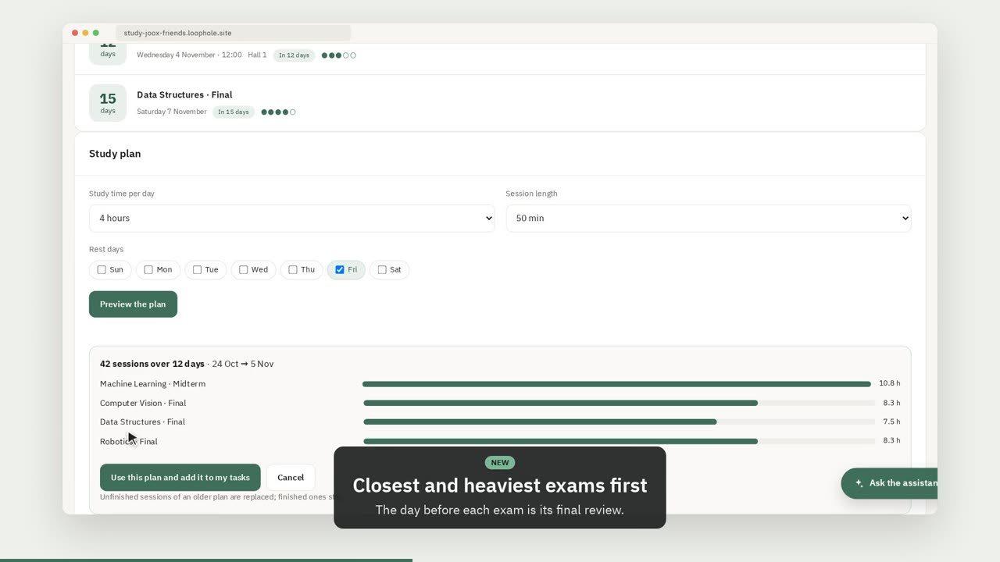
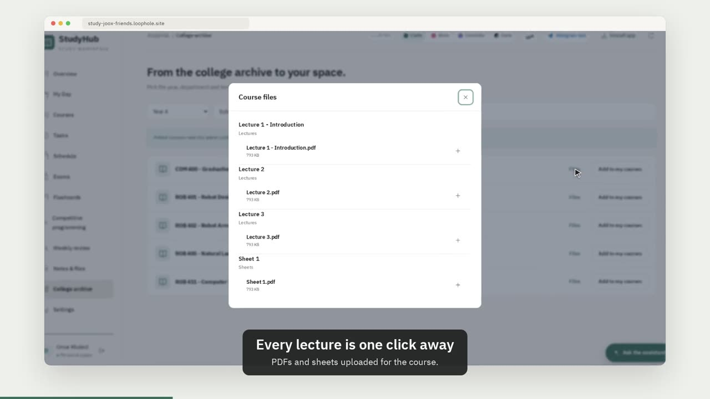

# StudyHub — مساحتي

A calm, self-hosted study workspace for university students. You get one place for courses, tasks with deadlines, the weekly timetable, Obsidian lecture notes and uploaded files. It runs on a small home server and installs as a PWA on phone and desktop. The interface is Arabic-first and has a one-click English switch, plus four colour themes: هادي (sage), وردي (rose), لافندر (lavender) and ليلي (dark).

It has two modes:

- **Personal site.** One owner, one password.
- **Friends site** (`STUDY_MULTIUSER=1`). Open sign-up, and every user gets private data on the server. A college archive can be shared read-only with everyone.

## Try it

The friends site is live at **https://study-joox-friends.loophole.site**. Open it, create an account (you may need an invite code from the owner) and install it on your phone from the browser menu.

## Video walkthrough

### For everyone (4 minutes)

[](docs/walkthrough-everyone.mp4)

Sign up, courses, the weekly timetable, tasks and deadline reminders, **exams and a one-click study plan**, the focus timer, **flashcards from your Obsidian notes**, **competitive programming (Codeforces + LeetCode)**, the AI assistant with a free Groq key, Obsidian notes, the weekly review, **the calendar link**, **sharing a course** and **the dark theme**.

### For HNU FCSIT students (2½ minutes)

[](docs/walkthrough-fcsit.mp4)

Sign up with the faculty code and pick your level and program. Add your courses from the college archive, get every assignment from the class channel as a task, plan your exams, link your Obsidian notes, share a course with your class, review with flashcards, and put it all in your phone's calendar.

The videos are made by [`docs/video/record.py`](docs/video/record.py), which drives a throwaway copy of the app with demo data, so they can be re-recorded after every change.

Downloads: [everyone](docs/walkthrough-everyone.mp4) · [FCSIT students](docs/walkthrough-fcsit.mp4). Subtitles: [everyone](docs/walkthrough-everyone.srt) · [FCSIT](docs/walkthrough-fcsit.srt). Transcripts: [everyone](docs/walkthrough-transcript-everyone.md) · [FCSIT](docs/walkthrough-transcript-fcsit.md).

## Features

- **Themes:** هادي, وردي, لافندر and ليلي (dark; picked automatically when the device is in dark mode and no theme has been chosen yet), switched from the top bar or the login page and saved per device. Every theme is a set of CSS variables in `static/app.css`, so adding one means adding one block.
- **Show / hide password:** an eye button on every password field (login, sign-up, password change, API key). It goes back to hidden whenever the form is sent.
- **Today and Overview:** the day's timetable, priorities, overdue tasks and a quick-add box.
- **Courses:** university and personal courses. Each one can be linked to an Obsidian folder and to the shared college archive.
- **Tasks:** status, priority and deadlines (Africa/Cairo time). A task has a do-date that is separate from its due date. A server-side focus timer survives page reloads.
- **Weekly review dashboard:** a Saturday-to-Friday week with focus minutes per day and per course, finished tasks, missed deadlines, a streak and a 12-week heatmap.
- **Library and reader:**
  - Obsidian-style Markdown: callouts, task lists, `==highlight==`, `%%comments%%`, wiki-links, KaTeX math and Mermaid diagrams.
  - Code highlighting, a table of contents and a reading-progress bar.
  - A collapsible folder tree.
- **Exams and a study plan:** enter your exam timetable (course, date, how heavy it is). One click spreads study sessions over the days left: the day before each exam is its final review, other days go to the closest and heaviest exam, and you choose the hours per day, the session length and rest days. Sessions are ordinary tasks, so they show up in Today, reminders and the weekly review. Countdowns sit on the overview.
- **Flashcards (spaced repetition):** cards with Again / Hard / Good / Easy grading on an SM-2 schedule like Anki, keyboard shortcuts (Space, 1–4) and a due count in the sidebar. Make them by hand, pull them out of an Obsidian note that uses the Spaced Repetition plugin syntax (`question :: answer`, `:::` for both ways, or a `?` line), or let the assistant write them from a note. You pick which drafts to keep.
- **Competitive programming:** add your Codeforces handle and/or LeetCode username to see rating, rank, solved problems, the daily streak, your strongest tags and recent solves. You also get a problem of the day (an unsolved Codeforces problem a bit above your rating, plus LeetCode's daily) and the upcoming Codeforces and LeetCode contests, one click from your plan.
- **Calendar link:** a private iCalendar link for Google Calendar, Apple Calendar or Outlook. It carries open deadlines, timed tasks, the weekly timetable, exams and (optionally) contests, and refreshes by itself.
- **Share a course (friends site):** make a code for a course and send it to classmates. Each of them gets their own copy of its notes, open tasks, timetable, upcoming exams and flashcards. Codes expire after 30 days and can be stopped at any time.
- **Deadline voice reminders:** Web Push reminders at 1 day, 12 hours and 1 hour before a deadline. Each stage plays a random clip from a folder of your own recorded voice notes.
- **College tasks from the class channels:** pluggable per faculty (see [Bring it to your faculty](#bring-it-to-your-faculty)). For HNU FCSIT students, every assignment posted on the HNU FCSIT WhatsApp channels for their level and program is added to their tasks with its deadline and course. The data comes from [HNU Board](https://github.com/moustafasayed068/hnu-board) by Moustafa Sayed.
- **In-app assistant (optional):** chat with any OpenAI-compatible model (Groq, Gemini, OpenRouter, Ollama…) that can create tasks, courses, timetable slots and notes for you. Each user can add their own free Groq, Gemini or OpenRouter key in Settings, with step-by-step instructions. The key is checked with the provider and stored encrypted. The site's own key, if set, is a capped fallback. A fallback provider takes over when the main one is rate-limited.
- **MCP server:** connect Claude (with your own subscription) as a custom connector. It gets 13 tools: today, tasks, courses, schedule, notes search/read/create, files and the weekly review. See [MCP.md](MCP.md).
- **Friends mode:**
  - Accounts: open sign-up and per-user data folders.
  - Limits: quotas and a daily assistant cap.
  - Vault import: Obsidian vault upload as a ZIP or a browser folder picker.
  - Per-user MCP tokens.
- **Security:**
  - Strict CSP, and every library is self-hosted with no CDN.
  - PBKDF2 password hashes; only hashes of tokens are stored.
  - Rate-limited login and sign-up.
  - Path-traversal-safe uploads and ZIP extraction.

## Stack

FastAPI with SQLite (JSON documents) on the server. The frontend is plain JavaScript and CSS with no build step: `static/`, a service worker and self-hosted KaTeX, Mermaid, highlight.js and IBM Plex Sans Arabic.

## Run it locally

The repository folder **is** the Python package `studyhub`, so clone it into a parent folder:

```bash
mkdir -p ~/studyhub && cd ~/studyhub
git clone https://github.com/yousefJooX/studyhub.git studyhub
python3 -m venv .venv
.venv/bin/pip install -r studyhub/requirements.txt

export STUDY_CONFIG_FILE=$PWD/data/config.json
export STUDY_SECURE_COOKIE=false            # only for plain http://localhost
.venv/bin/python -m studyhub init           # sets the owner password (12+ chars)
.venv/bin/python -m studyhub serve --port 8091
```

Then open <http://127.0.0.1:8091>.

`init` also takes two optional flags:

- `--vault-root PATH` points to an Obsidian vault copy on the server.
- `--archive-root PATH` points to a college archive data folder.

## CLI

| Command | What it does |
|---|---|
| `init` / `password` | Create the config or change the owner password |
| `serve` | Run the web app |
| `seed-vault` | Create courses from the vault's top-level folders |
| `token` | Create or rotate the MCP/API token and print the connector URL |
| `llm` | Configure the assistant's model provider and an optional fallback; it checks which models your key can use |
| `users list \| disable \| enable \| delete \| reset-password NAME` | Manage accounts on the friends site |

## Configuration

Settings live in `config.json` (path from `STUDY_CONFIG_FILE`, mode 600) or in environment variables.

| Key | Purpose |
|---|---|
| `STUDY_DATA_DIR` | Data folder (SQLite, uploads, vault, voice clips) |
| `STUDY_PUBLIC_ORIGIN` | Public HTTPS address (used for CORS, the MCP URL and Web Push) |
| `STUDY_OWNER_NAME` | Name shown in the greeting on the personal site |
| `STUDY_VAULT_ROOT`, `ARCHIVE_DATA_DIR` | Obsidian vault copy and the shared college archive |
| `STUDY_LLM_BASE_URL`, `STUDY_LLM_API_KEY`, `STUDY_LLM_MODEL` | Assistant model; set them with `python -m studyhub llm` |
| `STUDY_LLM_FALLBACK_*` | Optional second provider |
| `STUDY_MULTIUSER=1` | Friends mode |
| `STUDY_SIGNUP` | Friends-mode sign-up: `open` or `closed` |
| `STUDY_MAX_USERS` | Friends-mode account limit |
| `STUDY_USER_QUOTA_MB` | Friends-mode storage limit per user |
| `STUDY_ASSISTANT_DAILY` | Friends-mode assistant messages per user per day |
| `STUDY_SIGNUP_CODE` | Friends-mode invite code; when set, sign-up needs it |
| `STUDY_COLLEGE_CODE` | Faculty code (e.g. `cs`) that unlocks the college archive and college tasks; students also pick their level and program |
| `STUDY_COLLEGE_NAME` | Name of the faculty shown in the app |
| `STUDY_TELEGRAM_BOT` | Telegram bot username shown to faculty students (default `HNU_CS_bot`) |
| `STUDY_BOARD_URL`, `STUDY_BOARD_SYNC` | HNU Board address for college tasks; set `STUDY_BOARD_SYNC=0` to turn it off |
| `STUDY_COLLEGE_SOURCE` | Where college tasks come from: `hnu_board` (default), `json_feed` or `none` |
| `STUDY_COLLEGE_FEED_URL`, `STUDY_COLLEGE_SOURCE_NAME`, `STUDY_COLLEGE_HOME_URL` | The `json_feed` source: feed address with `{level}` and `{program}`, its display name and a link to its site |
| `STUDY_COLLEGE_LEVELS`, `STUDY_COLLEGE_PROGRAMS` | Number of years (default 4) and programs as `key=Name;key=Name` (default HNU FCSIT's DS, MSE, RSE) |
| `STUDY_TRUST_PROXY=1` | Take the client address from `X-Forwarded-For` even when the proxy is not on localhost (Docker) |
| `STUDY_MIN_FREE_MB` | Friends-mode uploads stop below this much free disk (default 2048) |

## Run it with Docker

```bash
git clone https://github.com/yousefJooX/studyhub.git && cd studyhub
docker compose run --rm studyhub init        # owner password (personal site; skip in friends mode)
docker compose up -d                         # http://127.0.0.1:8091
```

Data lives in the `studyhub-data` volume (`docker compose cp studyhub:/data ./backup` makes a copy). `compose.yaml` lists the common settings: friends mode, your Obsidian vault mounted read-only, the public address. The port is published on `127.0.0.1` only; put HTTPS in front of it (Caddy or a tunnel, below) before opening it to the internet. To try it on plain `http://localhost`, start it with `STUDY_SECURE_COOKIE=false docker compose up -d`.

## Bring it to your faculty

The college features (tasks from the class channels, announcements, levels and programs) are configured, not hard-coded. HNU FCSIT uses [HNU Board](https://github.com/moustafasayed068/hnu-board). Any other faculty can publish one JSON file per level and program and point StudyHub at it:

```bash
STUDY_COLLEGE_SOURCE=json_feed
STUDY_COLLEGE_FEED_URL=https://example.edu/studyhub/{level}/{program}.json
STUDY_COLLEGE_NAME="Faculty of Engineering"
STUDY_COLLEGE_LEVELS=5
STUDY_COLLEGE_PROGRAMS="power=Power Engineering;comm=Communications"
```

The feed format and how to write a new adapter are at the top of [`college_sources.py`](college_sources.py). Open an issue if you want help connecting your faculty.

## Deploy to a home server

`deploy/` has scripts that rsync the code to the server over SSH, restart the systemd service and run health checks:

```bash
cp deploy/deploy.env.example deploy/deploy.env    # your server, paths and address (git-ignored)
bash deploy/deploy_to_server.sh                   # deploy + restart
bash deploy/deploy_to_server.sh --token           # also rotate the MCP token
bash deploy/deploy_to_server.sh --dirty           # deploy uncommitted/unpushed work anyway
bash deploy/setup_friends.sh                      # one-time: friends site on port 8092 with its own HTTPS address
```

The deploy script refuses to run when the folder has uncommitted changes or differs from GitHub, so the server always runs a pushed commit.

For HTTPS you can put a domain behind Caddy (`deploy/Caddyfile.example`). The other option is a free [loophole](https://loophole.cloud) tunnel (`deploy/studyhub-tunnel.service.example`). The service template is `deploy/studyhub.service.example`.

## Tests

```bash
cd ~/studyhub                                   # the folder that contains the studyhub package
.venv/bin/pip install -r studyhub/requirements-dev.txt && .venv/bin/playwright install chromium
.venv/bin/python -m pytest studyhub/tests -q     # 132 tests, about 80 seconds (set STUDY_CHROME=/path/to/chrome to use a local Chrome for the browser tests)
```

GitHub Actions runs the same suite on every push to `main` (`.github/workflows/tests.yml`).

- **API**: every endpoint in both modes (personal and friends): accounts, isolation between users, the faculty code, quotas, timers, weekly review, vault, voices, push, archive access, own AI keys, the board sync (against captured HNU Board pages) and the MCP tools.
- **Browser** (Playwright): every page and dialog in Arabic and English, on desktop and phone, for students inside and outside the faculty. Any JavaScript error fails the test.
- **Unit**: Markdown/XSS, board parsers, encryption, rate-limit keys and week boundaries. Deploy scripts get a syntax check and the repo gets a check for leaked secrets.
- `tests/security_check.py` runs 30 attack checks against a running local instance.

## Security

- The app listens on `127.0.0.1` only; the public address comes from an HTTPS tunnel or reverse proxy.
- Passwords use PBKDF2. Sessions are random tokens stored hashed, in `HttpOnly`, `Secure`, `SameSite=Strict` cookies. API/MCP tokens are stored as SHA-256 hashes.
- Every client is rate-limited (`STUDY_RATE_LIMIT` requests per minute, default 300). Request bodies are capped at `STUDY_MAX_BODY_MB` (default 4) except on the authenticated upload routes.
- Login and sign-up are rate-limited per client address, per username and globally. Behind a local proxy, only the address the proxy adds last to `X-Forwarded-For` is trusted.
- Headers: a strict CSP (no inline scripts, no third-party hosts), HSTS, `X-Frame-Options: DENY`, `nosniff`, COOP and a Permissions-Policy.
- Writes are refused when they come from another origin. Uploads are checked for path traversal and symlinks. Documents other than images, PDF and media are served as downloads.
- Friends mode:
  - Every user's data lives in their own folder and database.
  - Set `STUDY_SIGNUP_CODE` to make sign-up need an invite code.
  - `STUDY_USER_QUOTA_MB` limits each user's storage, and uploads stop when the disk has less than `STUDY_MIN_FREE_MB` free.

`tests/security_check.py` runs 30 attack checks against a throwaway local instance: auth bypass, SQL injection, XSS, path traversal, IDOR, malicious uploads, zip-slip, zip bombs, CSRF, brute force, oversized requests and request floods. See the top of the file for how to run it.

Found a security problem? See [SECURITY.md](SECURITY.md) and report it privately instead of in a public issue.

## Never commit

`data/`, `config.json`, `deploy/deploy.env`, SQLite files and tokens are all git-ignored. Treat the MCP connector URL like a password.

## Contributing

Issues and pull requests are welcome, in Arabic or English. [CONTRIBUTING.md](CONTRIBUTING.md) covers running it locally, the tests and how the code is laid out. Want StudyHub for your own faculty? The college features are configured, not hard-coded; open an issue and we'll help you plug in your sources.

## Contributors

- [Yousef (yousefJooX)](https://github.com/yousefJooX): StudyHub.
- [Moustafa Sayed (moustafasayed068)](https://github.com/moustafasayed068): [HNU Board](https://github.com/moustafasayed068/hnu-board), which collects the faculty's channel posts by level and program. StudyHub's college tasks come from it, and the idea came from it.

## License

[MIT](LICENSE)
